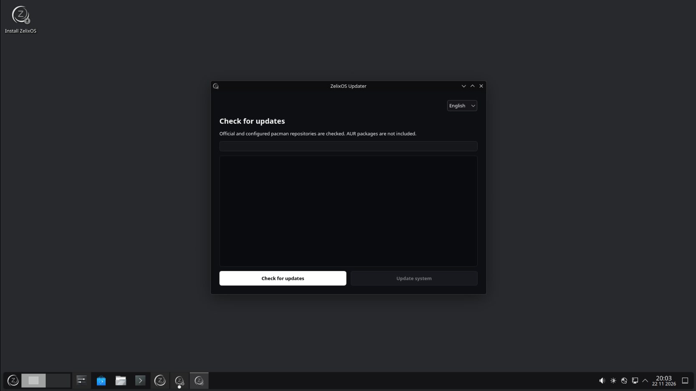

# Zelix Updater

Zelix Updater is a graphical front end for checking and installing updates from the pacman repositories configured on ZelixOS. It is written in Python and PyQt6 and shows status, progress, and update output in one window.



The interface supports English, Turkish, and Spanish. Language preference is saved for the current user and initially follows `LC_ALL`, `LC_MESSAGES`, then `LANG`.

## Install

On ZelixOS with ZelixRepo configured, update the package database and install:

```bash
sudo pacman -Syu zelix-updater
```

Open it from the application menu or run:

```bash
zelix-updater
```

## Use the updater

1. Start Zelix Updater and select the interface language if needed.
2. Choose **Check for updates**. The app runs `checkupdates` and lists available repository packages. If no updates are available, it reports that the system is current.
3. Review the list and select **Update system** when you are ready. The application asks for confirmation first.
4. Authenticate through the desktop Polkit prompt. Keep the computer powered on and wait for pacman output and the completion status.
5. Restart if an updated kernel, system library, or service requires it.

The update operation runs `pacman -Syu --noconfirm` through `pkexec`; pacman uses its default answers to prompts. Make sure you have a reliable network connection and power, and close work that should not be interrupted before starting.

### Scope

Zelix Updater updates packages in configured pacman repositories, including ZelixRepo when enabled. It does **not** update AUR or Flatpak applications. Use your AUR helper and `flatpak update` for those sources.

## Requirements

- ZelixOS or another Arch-based system with pacman repositories configured.
- A graphical desktop session with a Polkit authentication agent.
- `checkupdates` from `pacman-contrib` and `fakeroot` for update checks.
- Network access to the configured repositories.

If the check tools are missing, install them with `sudo pacman -Syu pacman-contrib fakeroot`. If an authorization dialog does not open, confirm that the desktop Polkit agent is running.

## Run from source

Install Python, PyQt6, Polkit, `pacman-contrib`, and `fakeroot`, then run from the project directory:

```bash
git clone https://github.com/ZelixOS/zelix-updater.git
cd zelix-updater
python main.py
```

The package installs its desktop entry and application icon. Its PKGBUILD is maintained in [ZelixRepo](https://github.com/ZelixOS/zelix-repo/tree/main/zelix-updater).

## Troubleshooting

| Problem | Check |
| --- | --- |
| Update check cannot start | Install `pacman-contrib` and `fakeroot`; confirm `checkupdates` is on `PATH`. |
| Repository refresh or downloads fail | Check network connectivity, pacman mirror configuration, and repository availability. |
| Update authorization fails | Confirm a Polkit authentication agent is active in the desktop session and retry. |
| Window closes or operation seems stuck | Wait for the pacman process to finish; do not close the app or power off while package changes are running. |
| AUR or Flatpak software remains outdated | Update it with its own tool; this application only handles pacman repositories. |

## Contributing

Include Zelix Updater and ZelixOS versions, the check/update action, the displayed error, and relevant pacman output in bug reports. Remove user names and private repository data before sharing logs. Update all three language strings when changing visible text.
